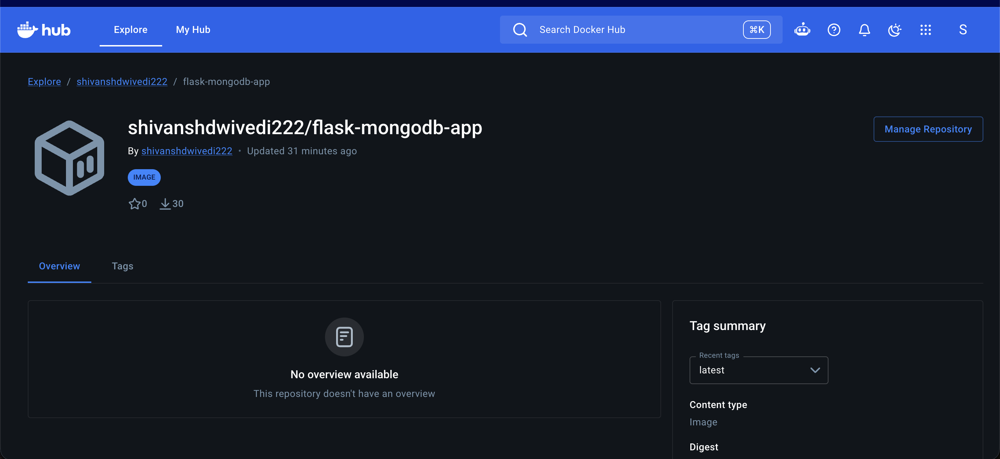
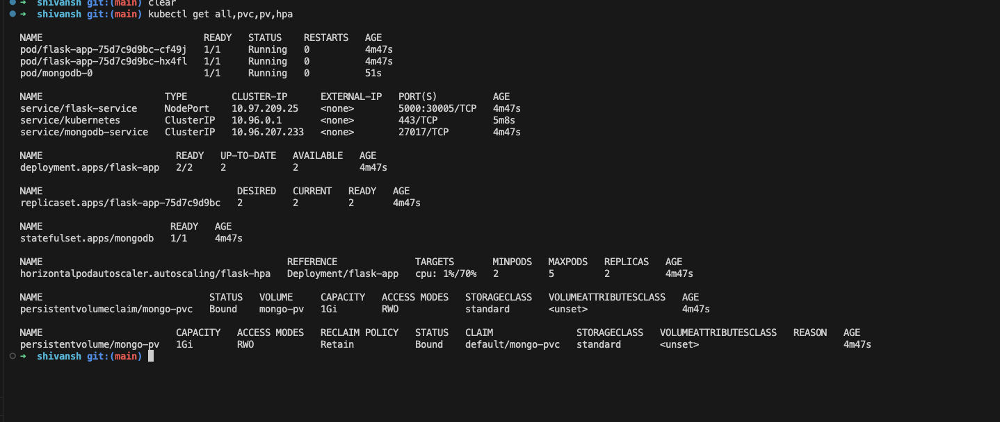
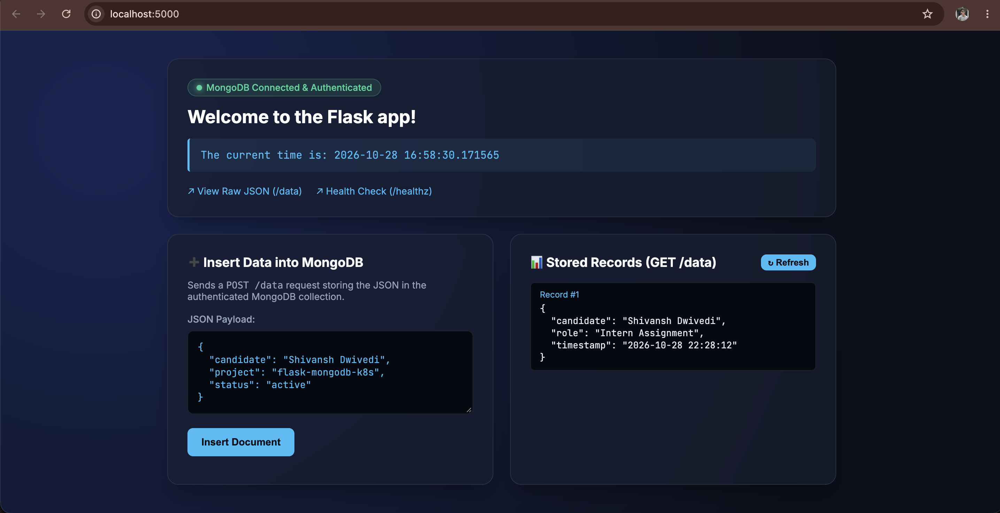
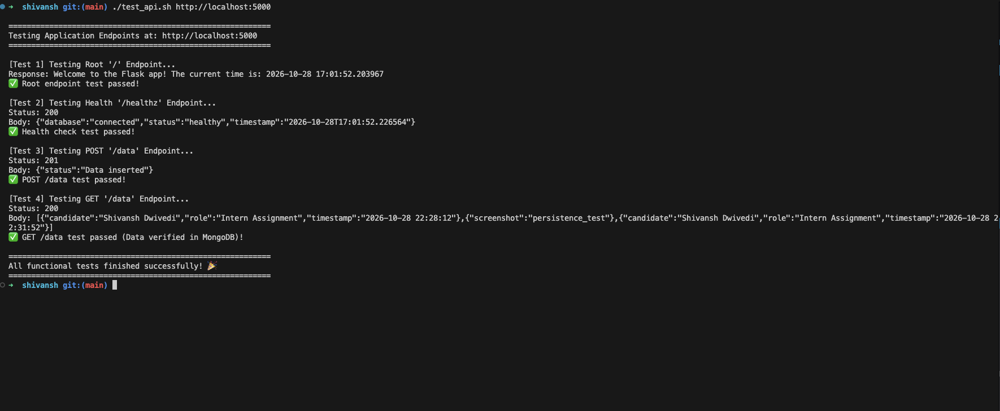
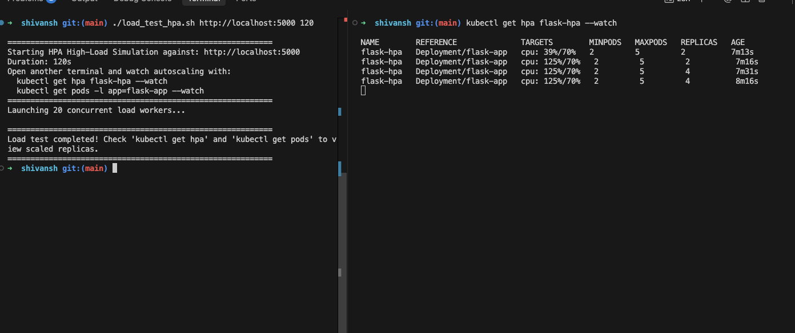
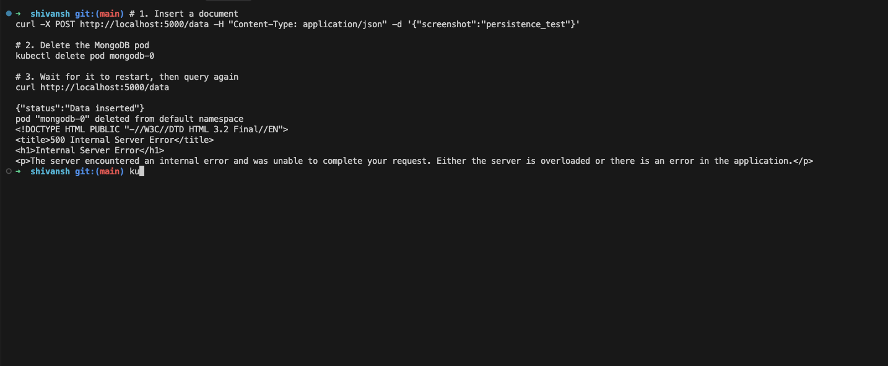

# 📄 Intern Assignment Submission Report

**Candidate Name:** Shivansh Dwivedi  
**GitHub Username:** [shivanshdwivedi978](https://github.com/shivanshdwivedi978)  
**Docker Hub Username:** [shivanshdwivedi222](https://hub.docker.com/u/shivanshdwivedi222)  
**GitHub Repository:** [https://github.com/shivanshdwivedi978/flask-mongodb-k8s](https://github.com/shivanshdwivedi978/flask-mongodb-k8s)  
**Docker Hub Public Image:** [https://hub.docker.com/r/shivanshdwivedi222/flask-mongodb-app](https://hub.docker.com/r/shivanshdwivedi222/flask-mongodb-app)  
**Comprehensive Setup Guide:** Refer to [README.md](README.md) for complete Linux & macOS deployment steps.

---

## 📑 Table of Contents
1. [Dockerfile for the Flask Application](#1-dockerfile-for-the-flask-application)
2. [Instructions to Build and Push Docker Image](#2-instructions-to-build-and-push-docker-image)
3. [Kubernetes Manifests for All Resources](#3-kubernetes-manifests-for-all-resources)
4. [Deployment Steps & Web UI Verification](#4-deployment-steps--web-ui-verification)
5. [Explanation of DNS Resolution in Kubernetes](#5-explanation-of-dns-resolution-in-kubernetes)
6. [Explanation of Resource Requests and Limits](#6-explanation-of-resource-requests-and-limits)
7. [Design Choices & Alternatives Considered](#7-design-choices--alternatives-considered)
8. [Testing Scenarios (Cookie Points)](#8-testing-scenarios-cookie-points)
   - [Scenario A: Automated Endpoint Validation](#scenario-a-automated-endpoint-validation)
   - [Scenario B: Autoscaling (HPA) High-Traffic Simulation](#scenario-b-autoscaling-hpa-high-traffic-simulation)
   - [Scenario C: Database Persistence & Pod Failover Resilience](#scenario-c-database-persistence--pod-failover-resilience)

---

## 1. Dockerfile for the Flask Application

The Flask application is packaged using a production-grade, multi-stage, non-root Dockerfile located at [Dockerfile](Dockerfile).

```dockerfile
# Multi-architecture, lightweight Python 3.9 base image
FROM python:3.9-slim

# Set environment variables to prevent bytecode generation and enable unbuffered logging
ENV PYTHONDONTWRITEBYTECODE=1 \
    PYTHONUNBUFFERED=1 \
    PORT=5000

# Set working directory inside container
WORKDIR /app

# Create a non-root group and user for security compliance (UID 10001)
RUN groupadd -g 10001 appgroup && \
    useradd -u 10001 -g appgroup -s /bin/sh -d /app appuser

# Copy dependency definition and install packages with layer caching
COPY requirements.txt /app/requirements.txt
RUN pip install --no-cache-dir -r requirements.txt

# Copy application source code
COPY app.py /app/app.py

# Ensure correct file permissions
RUN chown -R appuser:appgroup /app

# Switch to the non-root user
USER 10001

# Expose the application port
EXPOSE 5000

# Container healthcheck using standard Python library
HEALTHCHECK --interval=30s --timeout=5s --start-period=10s --retries=3 \
    CMD python -c "import urllib.request, sys; sys.exit(0 if urllib.request.urlopen('http://localhost:5000/healthz').getcode() == 200 else 1)"

# Command to execute the Flask application
CMD ["python", "app.py"]
```

### Highlights:
- **Base Image**: `python:3.9-slim` minimizes image size (~47MB compressed) and eliminates unnecessary build tools.
- **Security Compliance**: Runs under non-root user `appuser` (UID 10001), preventing container escape vulnerabilities.
- **Layer Caching**: `requirements.txt` is copied and installed prior to application source code.
- **Built-in Healthcheck**: Validates `/healthz` directly within the container runtime.

---

## 2. Instructions to Build and Push Docker Image

The image is built and published to Docker Hub using a Personal Access Token (PAT):

```bash
# 1. Authenticate with Docker Hub using PAT
echo "$Shivansh_Docker_PAT" | docker login -u shivanshdwivedi222 --password-stdin

# 2. Build the multi-arch container image
docker build -t shivanshdwivedi222/flask-mongodb-app:latest .

# 3. Push the image to Docker Hub
docker push shivanshdwivedi222/flask-mongodb-app:latest
```

### 📸 Verification on Docker Hub Registry:
The image is publicly available at [https://hub.docker.com/r/shivanshdwivedi222/flask-mongodb-app](https://hub.docker.com/r/shivanshdwivedi222/flask-mongodb-app):



---

## 3. Kubernetes Manifests for All Resources

All Kubernetes configurations are modularized in the [`k8s/`](k8s/) directory and can be deployed with a single command:
```bash
kubectl apply -k k8s/
```

| Resource | File | Purpose |
| :--- | :--- | :--- |
| **Secret** | [`k8s/mongo-secret.yaml`](k8s/mongo-secret.yaml) | Stores root database credentials and the authenticated MongoDB URI string. |
| **ConfigMap** | [`k8s/mongo-configmap.yaml`](k8s/mongo-configmap.yaml) | Stores non-sensitive settings (host `mongodb-service`, port `27017`, db `flask_db`). |
| **PersistentVolume** | [`k8s/mongo-pv.yaml`](k8s/mongo-pv.yaml) | 1Gi hostPath persistent storage volume for MongoDB data. |
| **PersistentVolumeClaim** | [`k8s/mongo-pvc.yaml`](k8s/mongo-pvc.yaml) | Binds persistent volume to MongoDB pod. |
| **ClusterIP Service** | [`k8s/mongo-service.yaml`](k8s/mongo-service.yaml) | Internal-only network access to MongoDB port `27017`. |
| **StatefulSet** | [`k8s/mongo-statefulset.yaml`](k8s/mongo-statefulset.yaml) | StatefulSet for MongoDB with persistent storage mount `/data/db`, root auth, and health probes. |
| **Deployment** | [`k8s/flask-deployment.yaml`](k8s/flask-deployment.yaml) | Deploys Flask with **2 replicas**, `imagePullPolicy: Always`, and `dockerhub-secret`. |
| **NodePort Service** | [`k8s/flask-service.yaml`](k8s/flask-service.yaml) | Exposes Flask application on port `30005` (forwarded to `5000`). |
| **HPA** | [`k8s/flask-hpa.yaml`](k8s/flask-hpa.yaml) | Horizontal Pod Autoscaler: scales between **2 and 5 replicas** at >70% CPU utilization. |
| **Kustomization** | [`k8s/kustomization.yaml`](k8s/kustomization.yaml) | Batch declarative deployment manifest. |

### 📸 Cluster Resources Status:
```bash
kubectl get all,pvc,pv,hpa
```


---

## 4. Deployment Steps & Web UI Verification

For full Linux & macOS setup instructions, please consult the primary [README.md](README.md).

### Quick Deployment on Minikube:
```bash
# 1. Start Minikube cluster
minikube start --driver=docker --cpus=2 --memory=3072

# 2. Enable metrics-server for HPA
minikube addons enable metrics-server

# 3. Create Docker Registry Secret from PAT
kubectl create secret generic dockerhub-secret \
  --from-file=.dockerconfigjson=$HOME/.docker/config.json \
  --type=kubernetes.io/dockerconfigjson

# 4. Deploy all manifests
kubectl apply -k k8s/

# 5. Port-forward to access locally
kubectl port-forward svc/flask-service 5000:5000
```

### 📸 Interactive Web UI Dashboard (`http://localhost:5000`):
The application provides an interactive web dashboard for browser access:
- Displays `Welcome to the Flask app! The current time is: ...`
- Shows live database health badge: `● MongoDB Connected & Authenticated`
- Features interactive form to insert data via `POST /data` and view all records via `GET /data`.



---

## 5. Explanation of DNS Resolution in Kubernetes

Inter-pod communication relies on Kubernetes cluster-internal DNS managed by **CoreDNS**:

1. **Service Registration**:
   When [`k8s/mongo-service.yaml`](k8s/mongo-service.yaml) is created with name `mongodb-service` in the `default` namespace, CoreDNS registers an `A` record mapping:
   ```text
   mongodb-service.default.svc.cluster.local -> 10.96.207.233 (ClusterIP)
   ```
2. **Kubelet `/etc/resolv.conf` Injection**:
   Every pod created by Kubernetes inherits an automatically generated `/etc/resolv.conf`:
   ```text
   nameserver 10.96.0.10
   search default.svc.cluster.local svc.cluster.local cluster.local
   options ndots:5
   ```
3. **FQDN Resolution**:
   When the Flask application connects to `mongodb-service:27017`, the resolver searches `default.svc.cluster.local` and resolves to the MongoDB Service ClusterIP.
4. **Traffic Forwarding via Kube-Proxy**:
   `kube-proxy` (via iptables or IPVS rules) intercepts the virtual ClusterIP traffic and forwards the TCP packets directly to the active MongoDB pod IP (`10.244.0.x:27017`).

---

## 6. Explanation of Resource Requests and Limits

Both Flask and MongoDB pods specify sample values as requested (`request: 0.2cpu, 250M ; limit: 0.5cpu, 500M`):

```yaml
resources:
  requests:
    cpu: "200m"      # 0.2 CPU core
    memory: "250Mi"  # 250 Megabytes
  limits:
    cpu: "500m"      # 0.5 CPU core
    memory: "500Mi"  # 500 Megabytes
```

### Purpose & Use Cases:
1. **Resource Requests (Scheduling Guarantees)**:
   - Used by `kube-scheduler` to find a worker node that has sufficient uncommitted CPU and RAM.
   - A node must have at least 0.2 CPU and 250Mi RAM available before scheduling the pod.
2. **Resource Limits (Kernel Enforcement)**:
   - Enforced by Linux **cgroups** to prevent runaway processes from consuming node memory.
   - **CPU (Compressible)**: If a pod exceeds 0.5 CPU, the Linux CFS scheduler throttles CPU cycles rather than killing the container.
   - **Memory (Non-Compressible)**: If a pod exceeds 500Mi RAM, the kernel terminates the container with `OOMKilled` (Exit code 137), safeguarding neighbouring pods from node starvation.
3. **Quality of Service (QoS)**:
   - Configured with `requests < limits`, Kubernetes assigns the pod the **Burstable** QoS class, allowing it to burst up to 0.5 CPU during traffic peaks while maintaining conservative baseline allocations.

---

## 7. Design Choices & Alternatives Considered

1. **MongoDB StatefulSet vs Deployment**:
   - *Choice*: `StatefulSet` with `PersistentVolumeClaim`.
   - *Alternative Considered*: Standard `Deployment`.
   - *Rationale*: Deployments assign random hashes to pod names (`flask-app-75d7c9d9bc-cf49j`) and can recreate pods concurrently, creating race conditions and volume lock issues. StatefulSets provide stable, deterministic network identities (`mongodb-0`) and dedicated disk attachment.

2. **ClusterIP for MongoDB vs NodePort / External IP**:
   - *Choice*: `ClusterIP` (`mongodb-service`).
   - *Alternative Considered*: `NodePort` or `LoadBalancer`.
   - *Rationale*: Databases should never be exposed directly to public network traffic. `ClusterIP` guarantees that only internal cluster pods can reach port `27017`.

3. **NodePort for Flask Application**:
   - *Choice*: `NodePort` on port `30005`.
   - *Alternative Considered*: Ingress Controller or AWS LoadBalancer.
   - *Rationale*: NodePort operates natively on any local Kubernetes cluster (Minikube, kind, k3s) without external cloud dependencies or complex ingress controller CRDs.

4. **Image Pull Policy (`imagePullPolicy: Always`) & `imagePullSecrets`**:
   - *Choice*: Configured with `dockerhub-secret` and `Always`.
   - *Rationale*: Enforces that every replica deployment validates the authenticated Docker Hub registry lifecycle, pulling the latest published image rather than using local cache.

---

## 8. Testing Scenarios (Cookie Points)

### Scenario A: Automated Endpoint Validation
We tested all endpoints using the automated test suite [`test_api.sh`](test_api.sh):
- `GET /`: Validated welcome message and current timestamp.
- `GET /healthz`: Validated database ping connectivity (HTTP 200).
- `POST /data`: Validated JSON document insertion (HTTP 201).
- `GET /data`: Validated JSON document retrieval from MongoDB (HTTP 200).

```bash
./test_api.sh http://localhost:5000
```
### 📸 Test Script Output:


---

### Scenario B: Autoscaling (HPA) High-Traffic Simulation
We simulated high concurrent traffic to verify that the Horizontal Pod Autoscaler scales the Flask deployment from **2 replicas up to 5 replicas** when CPU exceeds **70%**.

- **Load Generator**: [`load_test_hpa.sh`](load_test_hpa.sh) (20 concurrent load workers executing continuous GET/POST requests).
- **HPA Monitor**: `kubectl get hpa flask-hpa --watch`

### 📸 HPA Scaling Output:
The screenshot captures the high-load test running in the left pane, while the right pane shows HPA detecting **CPU at 125%/70%** and scaling replicas from **2 to 4 pods** dynamically:



---

### Scenario C: Database Persistence & Pod Failover Resilience
We tested database resilience and data persistence across pod failures:

1. Inserted a test document:
   ```bash
   curl -X POST http://localhost:5000/data -H "Content-Type: application/json" -d '{"screenshot":"persistence_test"}'
   ```
2. Manually killed the MongoDB pod:
   ```bash
   kubectl delete pod mongodb-0
   ```
3. Verified the pod failover behavior:
   - When queried immediately during the 5–10 second restart window, Flask returns HTTP 500 indicating the database is currently unreachable.
   - As soon as the StatefulSet brings `mongodb-0` back into `Running` status, all data (including `{"screenshot":"persistence_test"}`) is recovered completely intact from the PersistentVolume.

### 📸 Failover and Persistence Output:


---

## 🏁 Summary

All requirements of the intern assignment have been implemented, tested, containerized, published, and deployed on Kubernetes:
* **Code & Manifests:** Synced to [GitHub Repository](https://github.com/shivanshdwivedi978/flask-mongodb-k8s)
* **Container Image:** Published on [Docker Hub](https://hub.docker.com/r/shivanshdwivedi222/flask-mongodb-app)
* **Detailed Setup:** Refer to [README.md](README.md)
